# desarrollo-app

Proyecto final: Comprice móvil, compara precios del mercado en Cali y comparte presupuestos en vivo.

## Tabla de contenido

- [Descripción](#descripción)
- [Capturas](#capturas)
- [APIs de backend consumidas](#apis-de-backend-consumidas)
- [Requisitos](#requisitos)
- [Instalación](#instalación)
- [Uso](#uso)
- [Configuración](#configuración)
- [Pruebas](#pruebas)
- [Contribuir](#contribuir)
- [Licencia](#licencia)
- [Integrantes](#integrantes)

## Descripción

Comprice móvil busca un producto en seis supermercados de Cali (Éxito, Carulla, Olímpica, Jumbo, D1 y Mercamío), ordena las ofertas por precio por kilo, litro o unidad y deja armar un presupuesto por tienda que se comparte en tiempo real con otras cuentas. Es una app de Ionic React con Capacitor para Android, con Supabase como backend (login, base de datos con reglas de acceso, tiempo real y notificaciones) y la API propia de Comprice para los precios.

- Prototipo en Lovable: https://price-pick-budget-book.lovable.app (el prompt usado está en [`prototipo/prompt-lovable.md`](prototipo/prompt-lovable.md))
- Documento de alcance y tecnologías: [`docs/alcance.md`](docs/alcance.md)
- Rúbrica del proyecto: [`consigna/entrega-proyecto-final.pdf`](consigna/entrega-proyecto-final.pdf)

## Capturas

| Iniciar sesión | Crear cuenta | Buscar | Filtros |
| --- | --- | --- | --- |
| 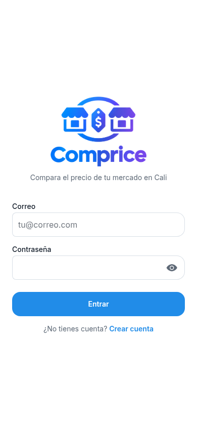 | 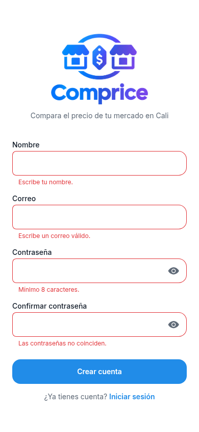 | 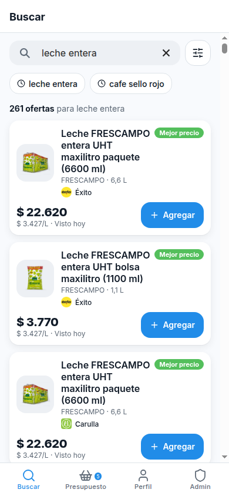 | 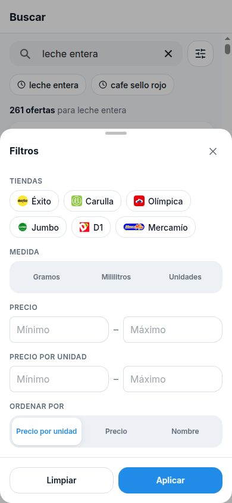 |

| Presupuesto | Compartir | Compartido conmigo | Presupuesto de otra persona |
| --- | --- | --- | --- |
| 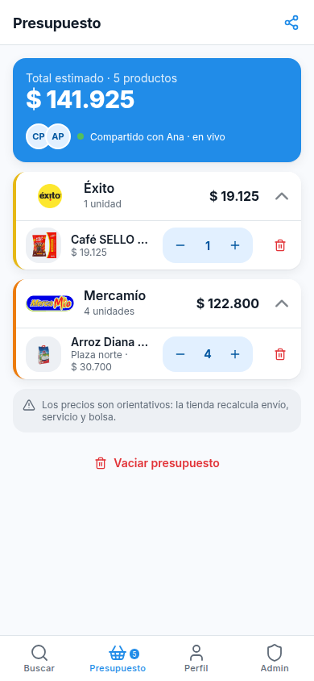 | 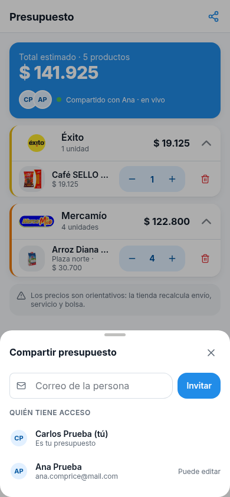 | 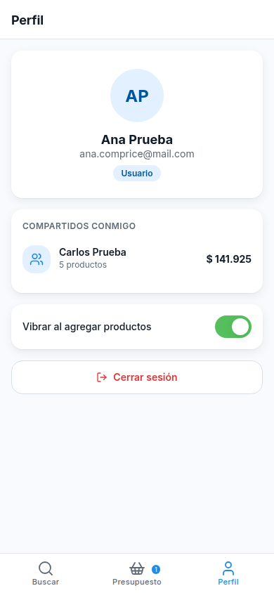 | 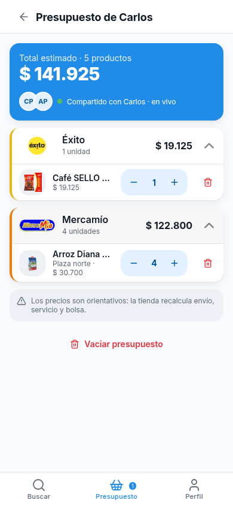 |

| Admin | Sin conexión (Galaxy A15) |
| --- | --- |
| 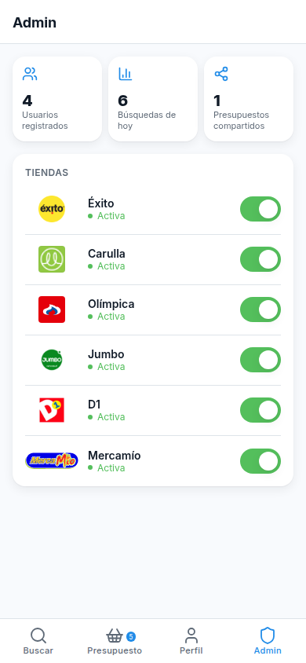 | 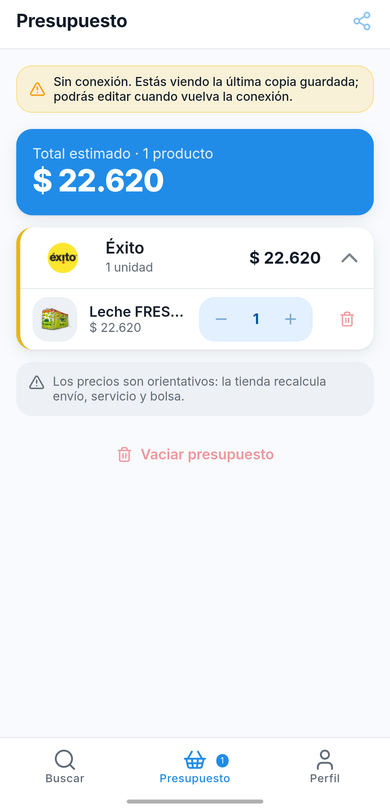 |

Notificaciones push en el celular:

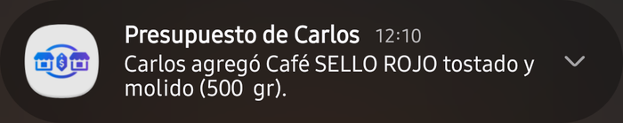

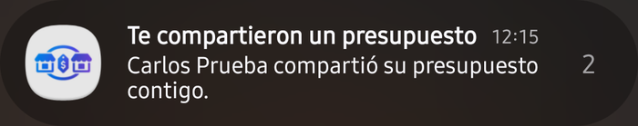

## APIs de backend consumidas

| API | Endpoint o recurso | Para qué |
| --- | --- | --- |
| API de Comprice (FastAPI propia) | `GET https://64.227.5.48.sslip.io/search` con `q`, `sort`, `stores`, `unit`, `min_price`, `max_price`, `min_price_per_unit` y `max_price_per_unit` | Buscar ofertas en las seis tiendas |
| Supabase Auth | `signUp`, `signInWithPassword`, `signOut` y `onAuthStateChange` | Registro, inicio de sesión y sesión persistente |
| Supabase Data API | Tablas `profiles`, `budget_items`, `budget_members`, `stores`, `searches` y `push_tokens` | Perfiles, presupuestos, tiendas, métricas y tokens |
| Supabase RPC | `invite_to_budget`, `save_push_token` y `admin_stats` | Compartir por correo, registrar el celular y métricas de admin |
| Supabase Realtime | `postgres_changes` de `budget_items`, `budget_members` y `stores` | Presupuesto compartido y tiendas en vivo |
| Supabase Edge Functions | `POST /functions/v1/send-push` | Avisar invitaciones y productos nuevos |
| Firebase Cloud Messaging | HTTP v1 `messages:send` (desde la Edge Function) | Entregar las notificaciones push |

## Requisitos

- Node.js 24
- JDK 21 (en Ubuntu, `openjdk-21-jdk-headless`)
- Android SDK con `platforms;android-36`, `build-tools;36.0.0` y `platform-tools`
- Un celular Android con la depuración por USB activada
- Un proyecto de Supabase con las migraciones de [`supabase/migrations`](supabase/migrations) y la función [`supabase/functions/send-push`](supabase/functions/send-push)
- Para push, la app Android `com.yeigen.comprice` registrada en el proyecto de Firebase `desarrollo-app-a610b` (su `google-services.json` ya está en `android/app/`)

## Instalación

```bash
npm install
```

En `android/local.properties` (ignorado por git) va la ruta del SDK:

```
sdk.dir=/home/<usuario>/Android/Sdk
```

## Uso

En el navegador:

```bash
npm run dev
```

Abre http://localhost:5173, crea una cuenta y busca un producto. Las vibraciones y las notificaciones push solo funcionan en el celular.

En el celular:

```bash
npm run build
npx cap sync android
cd android && ./gradlew assembleDebug
adb install -r app/build/outputs/apk/debug/app-debug.apk
```

Si el SDK está en WSL y el celular conectado a Windows, se instala con el `adb.exe` de Windows pasándole la ruta del APK en formato Windows (`wslpath -w`).

Para ver el tiempo real, entra con una cuenta en el navegador y con otra en el celular, comparte el presupuesto por correo y cambia una cantidad. Para las notificaciones, deja la app del celular en segundo plano y agrega un producto nuevo desde la otra cuenta.

## Configuración

| Variable | Archivo | Contenido |
| --- | --- | --- |
| `VITE_COMPRICE_API_URL` | `.env` | URL de la API de Comprice (no es secreta, se versiona) |
| `VITE_SUPABASE_URL` | `.env.local` | URL del proyecto de Supabase |
| `VITE_SUPABASE_PUBLISHABLE_KEY` | `.env.local` | Clave publishable del proyecto |
| `FCM_SERVICE_ACCOUNT` | Secreto de la Edge Function | JSON de la cuenta de servicio de Firebase para FCM HTTP v1 |

`.env.local` no se versiona. El rol de administrador se asigna con SQL en Supabase:

```sql
update public.profiles set role = 'admin' where email = '<correo>';
```

## Pruebas

```bash
npx tsc
npm run lint
npx vitest run
```

Las pruebas de punta a punta (tiempo real entre dos cuentas, reglas de acceso contra la API, modo sin conexión y notificaciones) se hicieron en el navegador y en un Samsung Galaxy A15; el detalle está en la sección Verificación de [`docs/alcance.md`](docs/alcance.md).

## Contribuir

Los commits siguen [Conventional Commits](https://www.conventionalcommits.org/en/v1.0.0/): tipo en inglés y descripción en español.

## Licencia

Proyecto académico, sin licencia definida.

## Integrantes

- Gabriel Martínez
