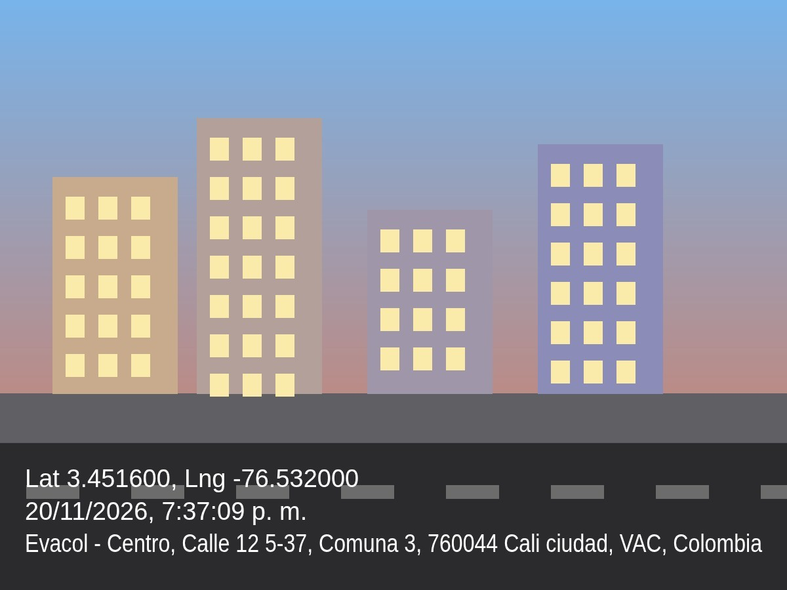

# desarrollo-app

Challenge 08: app de mapas y rastreo en Ionic React que combina GPS, acelerómetro, red, batería, cámara y OpenCage.

## Tabla de contenido

- [Descripción](#descripción)
- [Capturas](#capturas)
- [Decisiones](#decisiones)
- [Requisitos](#requisitos)
- [Instalación](#instalación)
- [Configuración](#configuración)
- [Uso](#uso)
- [Lo que solo se prueba en el celular](#lo-que-solo-se-prueba-en-el-celular)
- [Pruebas](#pruebas)
- [Contribuir](#contribuir)
- [Licencia](#licencia)

## Descripción

Parte de la app de sensores del challenge 7 (rama `challenge-7`) y la convierte en la app de mapas de la clase 10 (APIs y mapas): `@capacitor/geolocation`, `leaflet` + `react-leaflet` y un servicio con `fetch` para OpenCage. Home lleva a tres páginas: Mapa y rastreo, Historial y Foto con ubicación.

Lo que pide el challenge y dónde está:

| Pedido | Dónde |
| --- | --- |
| Revisar si hay wifi para pedir la dirección actual | `src/pages/MapPage.tsx`: con wifi la dirección se pide sola (y de nuevo solo si te moviste 150 m, `src/utils/places.ts`); con datos móviles hay un botón. Red en `src/hooks/useNetwork.ts` (`@capacitor/network`) |
| Mostrar el mapa | `src/components/TrackMap.tsx` (solo recibe props: centro, posición, recorridos y lugares) |
| Detectar si el celular se mueve para iniciar o pausar el rastreo | `src/hooks/useTracking.ts`: con el acelerómetro quieto un minuto se detiene `watchPosition` y vuelve al detectar movimiento (`isResting` en `src/utils/trackingRules.ts`) |
| Guardar el rastreo en un archivo JSON | `recorrido-AAAA-MM-DD.json` en Documentos, una sesión por cada inicio (`src/utils/tracks.ts` y `useFilesystem`) |
| Página de historial con el rastreo de un día | `src/pages/HistoryPage.tsx`: días guardados, el recorrido en el mapa y el resumen por sesión |
| Tomar una foto con la ubicación como marca de agua | `src/pages/PhotoPage.tsx` y `src/utils/watermark.ts`: latitud, longitud, fecha y dirección de OpenCage dibujadas en un canvas; se guarda como `foto-<hora>.jpg` en Documentos |
| Vibrar al iniciar el rastreo | `start` de `useTracking` llama a `useHaptics().vibrate()` |
| Detener el rastreo con batería baja | `useTracking` revisa la batería cada 10 s (`@capacitor/device`) y se detiene con 15 % o menos si no está cargando (`isBatteryLow`) |
| Avisos inteligentes: mucho tiempo sin moverse, sin conexión, movimiento rápido | `dueAlerts` en `src/utils/trackingRules.ts` decide; `useTracking` los envía con `@capacitor/local-notifications` y los lista en la página. Quieto 5 minutos, sin red, o más de 25 km/h; cada aviso espera 10 minutos antes de repetirse |
| Lugares cercanos con la API de OpenCage | `src/services/opencage.ts`, `src/hooks/useOpenCage.ts` y la sección Lugares cercanos del mapa |

El código que decide los avisos, la pausa y la batería:


Y el servicio de OpenCage:


## Capturas

Tomadas en el navegador con Playwright en un viewport de celular (390 x 844), con la ubicación simulada en el centro de Cali y moviéndola para simular el recorrido. La dirección y los lugares son respuestas reales de OpenCage.

| Home | Mapa | Rastreo a pie |
| --- | --- | --- |
|  |  |  |

| Pausa con el celular quieto | Aviso de movimiento rápido | Sin conexión |
| --- | --- | --- |
|  |  |  |

| Aviso sin conexión | Aviso sin moverse 5 minutos | Detenido por batería baja |
| --- | --- | --- |
|  |  |  |

| Lugares cercanos en el mapa | Lugares cercanos en lista | Historial del día |
| --- | --- | --- |
|  |  |  |

| Foto con ubicación | Sin key de OpenCage |
| --- | --- |
|  |  |

La foto guardada en Documentos, a tamaño completo, con la marca de agua:



Una sesión del archivo `recorrido-2026-11-20.json` (el archivo del día guarda todas las sesiones):


Cómo se simuló cada caso en el navegador:

- Recorrido: `context.setGeolocation` cada 3 s, unos 10 m por paso (12 km/h); el tramo rápido salta 130 m en 3 s.
- Pausa: un `DeviceMotionEvent` en reposo despachado en `window` (Motion en la web escucha `devicemotion`); a los 60 s el estado pasa a pausa y con un evento de movimiento vuelve a rastrear.
- Sin conexión: `context.setOffline(true)`.
- Batería: `navigator.getBattery` reemplazado con un nivel de 82 % que luego baja a 10 %.
- Foto: el selector de archivos de la cámara web (`webUseInput`) con una imagen de prueba.
- Sin key: otra instancia de Vite con `VITE_OPENCAGE_API_KEY` vacía; no se hizo ninguna petición a OpenCage.

## Decisiones

- **Páginas.** Las páginas de un sensor suelto del challenge 7 (Cámara, Dispositivo, Archivos, Ubicación, Vibración, Notificaciones locales, Movimiento y Push) se quitaron, porque ahora cada sensor sirve dentro del rastreo. Los hooks se conservaron y se ajustaron: funciones estables con `useCallback`, un callback por posición en `useGeolocation`, `readText` y `writeBase64` en `useFilesystem`, y `useDevice` solo con la batería. Push y su plugin salieron porque la consigna no los usa.
- **Nombre.** `appName` pasó a "Rastreo"; el `appId` sigue siendo `com.yeigen.sensores` para no cambiar el paquete de Android ni el `google-services.json` de Firebase.
- **Los hooks no se conocen entre sí.** `useTracking` es el único que los combina; las reglas (velocidad, pausa, batería, avisos, días, lugares) son funciones puras en `src/utils/` con sus pruebas.
- **Lecturas sin sensor.** En un equipo sin acelerómetro, Chromium entrega `devicemotion` con `x`, `y`, `z` en `null`, que se medían como movimiento. `hasReading` las descarta; sin lecturas el rastreo nunca se pausa.
- **Precisión.** Se descartan posiciones con precisión peor que 30 m y puntos a menos de 5 m del anterior, para no llenar el JSON de ruido del GPS.
- **OpenCage es un geocodificador, no un buscador de lugares.** El reverse geocoding devuelve la dirección y, si hay uno muy cerca, el nombre del sitio (por ejemplo "Evacol - Centro, Calle 12 5-37..."). Para los lugares cercanos se hace una búsqueda directa con la palabra de la categoría (restaurante, droguería, banco, hotel), `proximity` en la posición y `bounds` de 2 km a la redonda. OpenCage solo encuentra los sitios cuyo nombre contiene esa palabra y que están en sus datos (OpenStreetMap); no encuentra, por ejemplo, un restaurante que no tenga "restaurante" en el nombre, y su propia guía dice que no reemplaza a Google Places. Los resultados que no son el lugar buscado (un barrio, por ejemplo) se descartan y el resto se ordena por distancia.
- **Consumo de la key.** El plan gratis tiene 2.500 peticiones al día. La dirección se pide sola solo con wifi y de nuevo tras moverse 150 m; los lugares, solo al tocar el botón.
- **Teselas.** La URL va en `VITE_MAP_TILES_URL` (`.env`, se versiona porque no es secreta), con la atribución "© OpenStreetMap contributors" y `appendUserAgent: 'Rastreo/0.0.1'` en `capacitor.config.ts`, como pide la política de teselas de OpenStreetMap.

## Requisitos

- Node.js 24
- JDK 21 (en Ubuntu, `openjdk-21-jdk-headless`)
- Android SDK con `platforms;android-36`, `build-tools;36.0.0` y `platform-tools`
- Una key de [OpenCage](https://opencagedata.com/api) para la dirección y los lugares cercanos

## Instalación

```bash
npm install
```

En `android/local.properties` (ignorado por git) va la ruta del SDK:

```
sdk.dir=/home/<usuario>/Android/Sdk
```

## Configuración

| Variable | Archivo | Para qué |
| --- | --- | --- |
| `VITE_MAP_TILES_URL` | `.env` (versionado) | URL de las teselas del mapa |
| `VITE_OPENCAGE_API_KEY` | `.env.local` (ignorado por git) | Key de OpenCage |

```bash
cp .env.example .env.local
```

Y se llena `VITE_OPENCAGE_API_KEY` en `.env.local`. Sin key la app funciona igual, pero muestra un aviso en lugar de la dirección y los lugares, y la marca de agua lleva solo coordenadas y fecha. La key queda dentro del build de la app (es una variable `VITE_`), así que conviene restringirla en el panel de OpenCage.

## Uso

En el navegador:

```bash
npm run dev
```

1. Abre Mapa y rastreo y toca "Iniciar rastreo": el celular vibra, se pide permiso de notificaciones y cada posición se guarda en el JSON del día.
2. Camina: el recorrido aparece en azul. Con el celular quieto un minuto el rastreo se pausa y vuelve al moverlo.
3. En Lugares cercanos elige una categoría y toca "Buscar cerca de mí".
4. En Historial elige un día para ver sus sesiones en el mapa.
5. En Foto con ubicación toma una foto: sale con la marca de agua y se guarda en Documentos.

En el celular:

```bash
npm run build
npx cap sync android
cd android && ./gradlew assembleDebug
adb install -r app/build/outputs/apk/debug/app-debug.apk
```

## Lo que solo se prueba en el celular

No había un celular conectado; todo lo de arriba se probó en el navegador y el APK se compiló sin instalarlo. Falta comprobar en el celular:

- La vibración al iniciar (en la web `Haptics` usa `navigator.vibrate`, que un navegador de escritorio ignora).
- Las notificaciones del sistema (en la web salen con la API `Notification`; la captura muestra la lista de avisos de la página).
- El nivel real de la batería y la carga.
- El acelerómetro real y los umbrales de pausa (en la web se despacharon eventos).
- La cámara nativa y la foto en `/sdcard/Documents`, y los permisos de ubicación y notificaciones de Android.

## Pruebas

```bash
npx vitest run
npx eslint .
```

Las pruebas cubren la lógica pura: distancia y velocidad, pausa, batería baja, avisos y su espera, archivos por día y sesiones, lugares cercanos, cuándo pedir otra vez la dirección, marca de agua y formatos.


## Contribuir

Los commits siguen [Conventional Commits](https://www.conventionalcommits.org/en/v1.0.0/): tipo en inglés y descripción en español.

## Licencia

Proyecto académico, sin licencia definida.
