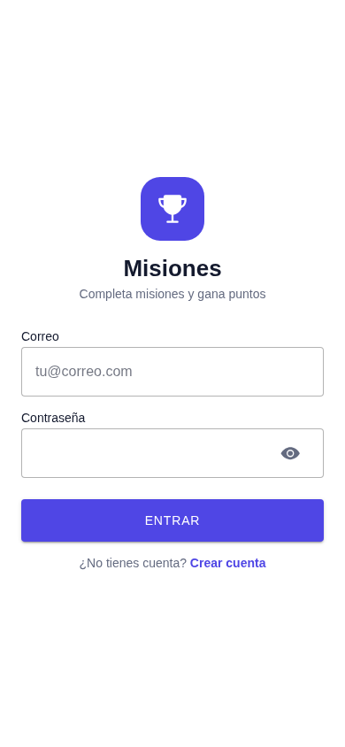
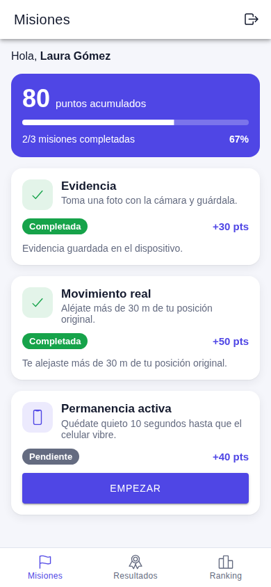
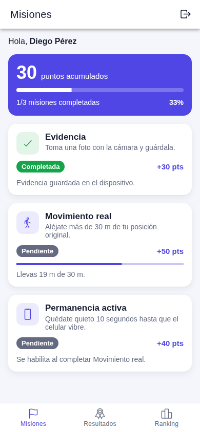
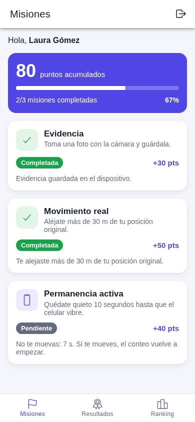
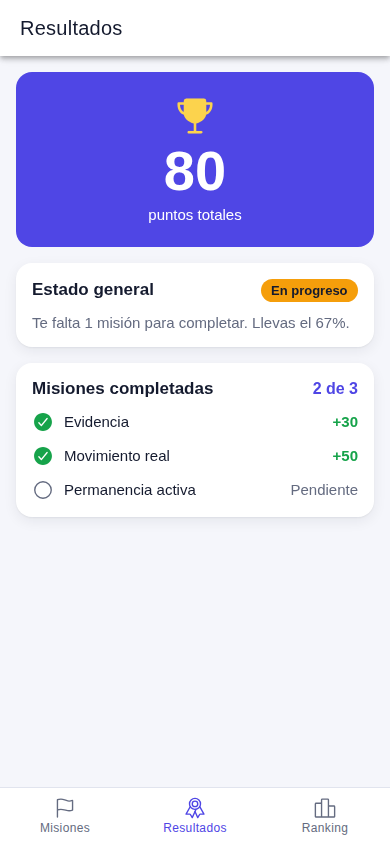
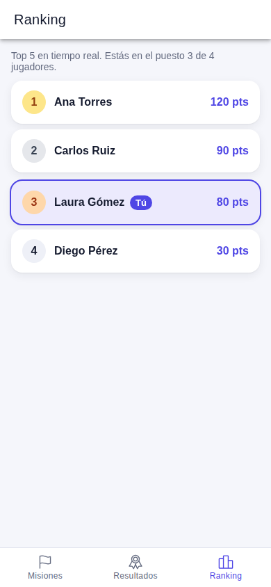

# Parcial 2, Desarrollo de Plataformas Móviles

App de misiones con puntos: foto, GPS y acelerómetro con Ionic React, Capacitor y Firebase.

Autor: Gabriel Martínez. Rama de entrega: `parcial-2-gabriel-martinez`. Enunciado: [`consigna/parcial-2.md`](consigna/parcial-2.md).

## Tabla de contenido

- [Descripción](#descripción)
- [Capturas](#capturas)
- [Cómo se cumple cada requisito](#cómo-se-cumple-cada-requisito)
- [Decisiones](#decisiones)
- [Requisitos](#requisitos)
- [Instalación](#instalación)
- [Uso](#uso)
- [Configuración](#configuración)
- [Pruebas](#pruebas)
- [Estructura](#estructura)
- [Contribuir](#contribuir)
- [Licencia](#licencia)

## Descripción

Cada usuario se registra con su correo, desbloquea y completa tres misiones que usan sensores reales del celular, y gana puntos que se guardan en Firebase y en el dispositivo. El ranking muestra en tiempo real el top 5 de usuarios reales y te ubica frente a los demás.

| Misión | Lógica | Puntos |
| --- | --- | --- |
| Evidencia | Toma una foto con la cámara; se completa al guardarla en el dispositivo | 30 |
| Movimiento real | Sigue el GPS desde tu posición original; se completa al pasar de 30 m | 50 |
| Permanencia activa | Se habilita después del movimiento; con el acelerómetro cuenta 10 s quieto y vibra | 40 |

## Capturas

| Iniciar sesión | Misiones | Caminando |
| --- | --- | --- |
|  |  |  |

| Quieto 10 segundos | Resultados | Ranking |
| --- | --- | --- |
|  |  |  |

## Cómo se cumple cada requisito

| Requisito | Cómo | Dónde |
| --- | --- | --- |
| Usuarios reales con login y registro | Firebase Auth con correo y contraseña; el nombre queda en el perfil y en el progreso | [`useFirebaseAuth`](src/hooks/useFirebaseAuth.ts), [`Login`](src/pages/Login/Login.tsx), [`Signup`](src/pages/Signup/Signup.tsx) |
| Lista de misiones con estado y puntos | Cada tarjeta muestra Pendiente o Completada y sus puntos | [`MissionCard`](src/components/missions/MissionCard.tsx), [`Missions`](src/pages/Missions/Missions.tsx) |
| Misión 1: foto y guardar | `Camera.takePhoto` y `Filesystem.writeFile` en la carpeta privada de la app | [`useEvidencePhoto`](src/hooks/useEvidencePhoto.ts) |
| Misión 2: cambio de ubicación mayor a 30 m | `Geolocation.watchPosition` y distancia con la fórmula de haversine | [`useWalkTracker`](src/hooks/useWalkTracker.ts), [`geo.ts`](src/helpers/geo.ts) |
| Misión 3: quieto 10 s y vibrar, sin bloquear la pantalla | Listener de `Motion` y `Haptics.vibrate`; el conteo corre con eventos, sin bloquear la interfaz | [`useStillTimer`](src/hooks/useStillTimer.ts), [`motion.ts`](src/helpers/motion.ts) |
| Total de puntos y barra de progreso | Puntos, porcentaje y misiones completadas / total | [`ProgressSummary`](src/components/shared/ProgressSummary.tsx) |
| Persistencia en Firebase y local | Firestore `progress/{uid}` y `localStorage` con el formato `{ points, missions: [{ id, completed }] }` | [`progress.ts`](src/services/progress.ts), [`useFirestoreProgress`](src/hooks/useFirestoreProgress.ts) |
| Pantalla de resultados | Puntos totales, misiones completadas y estado general | [`Results`](src/pages/Results/Results.tsx) |
| Notificaciones locales | "Has completado una misión" y "Te falta 1 misión para completar" | [`notifications.ts`](src/services/notifications.ts) |
| Ranking top 5 con usuarios reales | `onSnapshot` de toda la colección; si estás fuera del top 5 apareces con tu puesto real frente a los otros 4 | [`ranking.ts`](src/helpers/ranking.ts), [`Ranking`](src/pages/Ranking/Ranking.tsx) |
| Hooks y manejo de estado | Un hook por sensor; `AuthContext` y `ProgressContext` comparten la sesión y el progreso | [`src/hooks`](src/hooks), [`src/context`](src/context) |

## Decisiones

- **30 m y no 50 m.** El enunciado dice "moverse 50 metros" en la lista y "distancia > 30m" en la condición; se usa la condición.
- **GPS confiable.** Se ignoran las lecturas con precisión peor que 20 m, para que un salto de la señal bajo techo no complete la misión sin caminar.
- **Quieto según el acelerómetro.** Se mide `|√(x² + y² + z²) − 9,81|` con `accelerationIncludingGravity`, porque el Galaxy A15 de pruebas no tiene giroscopio y entrega `acceleration` en cero. Por encima de 2 m/s² cuenta como movimiento y el conteo vuelve a 10 s.
- **Puntos que no se pierden.** Al abrir la app se une la copia local con la de Firestore: una misión cuenta como completada si lo está en cualquiera de las dos, y los puntos siempre se recalculan desde las misiones.
- **Reglas de Firestore.** Cualquier usuario con sesión lee el ranking; cada uno escribe solo su documento, con los campos permitidos, de 0 a 120 puntos, exactamente 3 misiones y la hora del servidor. Ver [`firestore.rules`](firestore.rules).

## Requisitos

- Node.js 24 y npm 11
- Para Android: JDK 21 y Android SDK (o Android Studio 2025.2.1 o más reciente), y un celular con la depuración por USB activada
- El proyecto de Firebase `desarrollo-app-a610b` con Authentication (correo y contraseña) y Firestore

## Instalación

```bash
git clone -b parcial-2-gabriel-martinez https://github.com/yeigen/desarrollo-app.git
cd desarrollo-app
npm install
```

Para Android, la ruta del SDK va en `android/local.properties` (ignorado por git):

```
sdk.dir=/home/<usuario>/Android/Sdk
```

## Uso

En el navegador:

```bash
npm run dev
```

Abre http://localhost:5173 y crea una cuenta. En la web la cámara abre el selector de archivos y la ubicación sale del navegador; la misión 3 necesita el acelerómetro del celular.

En el celular:

```bash
npm run build
npx cap sync android
cd android && ./gradlew assembleDebug
adb install -r app/build/outputs/apk/debug/app-debug.apk
```

Para completar la misión 2 hay que caminar más de 30 m al aire libre, donde el GPS logra la precisión de 20 m.

## Configuración

| Archivo | Contenido |
| --- | --- |
| [`src/services/firebase.ts`](src/services/firebase.ts) | Configuración web de Firebase. La `apiKey` web identifica el proyecto y no es secreta; los datos los protegen las reglas |
| [`firestore.rules`](firestore.rules) | Reglas de Firestore, que conservan las del challenge 6 del mismo proyecto |
| [`capacitor.config.ts`](capacitor.config.ts) | App `com.yeigen.misiones` y estilo de la barra de estado |

Las reglas se despliegan con:

```bash
npx firebase-tools deploy --only firestore:rules
```

## Pruebas

```bash
npx tsc --noEmit
npm run lint
npx vitest run
```

Las pruebas unitarias cubren las reglas del juego: sumar puntos sin repetirlos, el formato guardado, el desbloqueo de la misión 3, la unión de la copia local con Firebase, la distancia por GPS, cuándo el acelerómetro indica movimiento y el top 5 con tu puesto. Además se comprobaron en el navegador los flujos completos (registro, las tres misiones, resultados y ranking) y las reglas de Firestore contra la API: leer sin sesión, escribir el progreso de otro, ponerse 999 puntos, agregar campos o borrar el progreso devuelven 403.

## Estructura

```
src/
  components/  auth (formulario), missions (una tarjeta por misión), shared (resumen de progreso)
  context/     AuthContext y ProgressContext con sus providers
  helpers/     reglas puras del juego y sus pruebas: misiones, distancia, movimiento, ranking, validación
  hooks/       sesión, progreso, ranking y un hook por sensor (cámara, GPS, acelerómetro)
  pages/       Login, Signup, Missions, Results, Ranking
  routes/      AppRoutes (públicas y privadas) y UserRoutes (pestañas)
  services/    Firebase, progreso en Firestore y localStorage, notificaciones locales
```

## Contribuir

Los commits siguen [Conventional Commits](https://www.conventionalcommits.org/en/v1.0.0/): tipo en inglés y descripción en español.

## Licencia

Proyecto académico, sin licencia definida.
