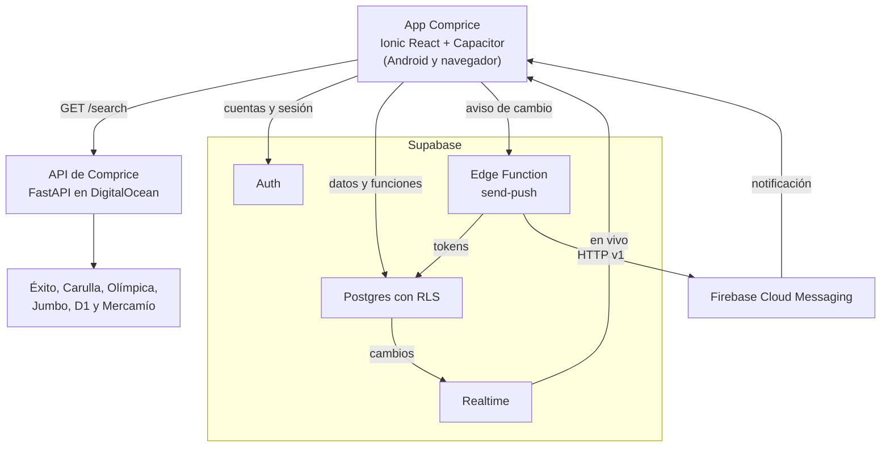

# Documento de alcance: Comprice móvil

Proyecto final de Desarrollo de Aplicaciones Móviles (UAO), elaborado por Gabriel Martínez. Corresponde a la rama `proyecto-comprice` del repositorio `desarrollo-app` y describe el estado del 24 de octubre de 2026.

## 1. Problema y objetivo

Comparar el precio del mercado en Cali obliga a revisar la página de cada supermercado, y cada uno vende el mismo producto en presentaciones distintas. Comprice móvil busca un producto en seis supermercados a la vez, ordena las ofertas por precio por kilo, litro o unidad, y permite armar un presupuesto por tienda que se comparte en tiempo real con otras personas, por ejemplo con quien hace el mercado en la misma casa.

## 2. Alcance funcional

### Incluido

| Funcionalidad | Qué hace | Dónde |
| --- | --- | --- |
| Registro e inicio de sesión | Cuentas reales con correo y contraseña de mínimo 8 caracteres; la sesión se conserva al cerrar la app | Login, Crear cuenta |
| Búsqueda de ofertas | Consulta en vivo Éxito, Carulla, Olímpica, Jumbo, D1 y Mercamío; marca el mejor precio por unidad y avisa si una tienda no respondió | Buscar |
| Filtros | Tiendas, medida (gramos, mililitros, unidades), rangos de precio y de precio por unidad, y orden | Buscar > Filtros |
| Búsquedas recientes | Las últimas cinco búsquedas quedan guardadas en el celular | Buscar |
| Presupuesto | Productos agrupados por tienda con subtotal, cantidades de 1 a 999 y total estimado | Presupuesto |
| Compartir en tiempo real | Se invita por correo a otra cuenta, que puede editar; los cambios de cualquiera se ven en vivo en todos los celulares | Presupuesto > Compartir |
| Compartidos conmigo | Lista de los presupuestos de otras personas, con su total, que se abren desde el perfil | Perfil |
| Sin conexión | La app abre con la última copia del presupuesto, el perfil y los compartidos, y bloquea la edición hasta que vuelva la red | Toda la app |
| Vibración | Vibra al agregar un producto; se puede apagar y la preferencia queda en el celular | Buscar, Perfil |
| Notificaciones push | Avisan cuando alguien comparte su presupuesto contigo o agrega un producto a un presupuesto compartido; al tocarlas se abre ese presupuesto | Android |
| Administración | Métricas reales (usuarios, búsquedas del día, presupuestos compartidos) y activar o desactivar tiendas para todos en vivo | Admin |

### Fuera de alcance

| Funcionalidad | Motivo |
| --- | --- |
| Escáner de código de barras | Estaba en el prototipo; se quitó por decisión del proyecto |
| Preparar el carrito en la tienda | El backend lo exige ligado al presupuesto de la versión web, que no es el de la app |
| Pago y compra | La compra se termina en cada supermercado |
| Editar sin conexión | Se eligió solo lectura para no tener que resolver conflictos entre cambios |
| Confirmación de correo y recuperación de contraseña | El correo por defecto de Supabase solo envía al equipo del proyecto y dos mensajes por hora |
| Nombrar varios presupuestos | Cada cuenta tiene un presupuesto |
| iOS | La app se construye con Capacitor y no tiene nada exclusivo de Android salvo push, pero solo se probó en Android |

## 3. Usuarios y roles

| Rol | Puede | Cómo se asigna |
| --- | --- | --- |
| Usuario | Buscar, armar y compartir su presupuesto, editar los presupuestos que le compartieron | Al registrarse |
| Administrador | Lo mismo que un usuario, más la pestaña Admin: métricas y activar o desactivar tiendas | Solo por SQL en Supabase; nadie puede darse el rol desde la app ni desde la API |

## 4. Arquitectura

- La búsqueda de precios usa el backend de Comprice ya desplegado, que consulta las tiendas en vivo y guarda un caché diario. En el celular la llamada pasa por `CapacitorHttp` porque esa API no envía CORS; en desarrollo pasa por el proxy de Vite.
- Supabase es el backend como servicio: Auth para las cuentas, Postgres para los datos con reglas de acceso (RLS) en cada tabla, Realtime para el presupuesto compartido y las tiendas, y una Edge Function para las notificaciones.
- La Edge Function `send-push` recibe el aviso de la app con la sesión del usuario, comprueba con sus permisos que el cambio existe, busca los tokens de los destinatarios y envía por FCM HTTP v1 con una cuenta de servicio de Firebase guardada como secreto.

## 5. Tecnologías utilizadas

| Capa | Tecnología | Versión | Para qué |
| --- | --- | --- | --- |
| Prototipo | Lovable | | Diseño de referencia de las pantallas |
| Interfaz | Ionic React | 9.0.9 | Componentes móviles, pestañas, hojas y alertas |
| Interfaz | React | 19.0.0 | Componentes, contextos y hooks |
| Interfaz | React Router | 6.30.6 | Rutas de la app |
| Interfaz | TypeScript | 5.9.3 | Tipado de todo el código |
| Interfaz | Sass (CSS Modules) | 1.106.1 | Estilos `.module.scss` por componente |
| Interfaz | lucide-react | 1.61.0 | Íconos |
| Nativo | Capacitor | 8.5.3 | App Android, `CapacitorHttp` y barras del sistema |
| Nativo | @capacitor/haptics | 8.0.2 | Vibración al agregar |
| Nativo | @capacitor/preferences | 8.0.1 | Preferencias y copia local |
| Nativo | @capacitor/network | 8.0.1 | Saber si hay conexión |
| Nativo | @capacitor/push-notifications | 8.1.3 | Recibir notificaciones de FCM |
| Backend como servicio | Supabase (Auth, Postgres 17, Realtime, Edge Functions) | supabase-js 2.118.0 | Cuentas, datos, tiempo real y notificaciones |
| Backend como servicio | Firebase Cloud Messaging | HTTP v1 | Entrega de las notificaciones push |
| Backend propio | API de Comprice (FastAPI) | | Búsqueda de precios en las tiendas |
| Herramientas | Vite | 8.3.5 | Servidor de desarrollo y compilación |
| Herramientas | Vitest | 4.0.18 | Pruebas |
| Herramientas | ESLint | 9.39.5 | Revisión del código |

## 6. Modelo de datos

Las migraciones están en [`supabase/migrations`](../supabase/migrations) y la Edge Function en [`supabase/functions/send-push`](../supabase/functions/send-push).

| Tabla | Contenido | Quién puede qué |
| --- | --- | --- |
| `profiles` | Nombre, correo y rol de cada cuenta; la crea un trigger al registrarse | Cada usuario lee su perfil y el de las personas con las que comparte presupuesto; nadie lo modifica desde la API |
| `budget_items` | Productos del presupuesto de cada dueño: oferta, cantidad (1 a 999) | El dueño y las personas invitadas leen y editan |
| `budget_members` | Quién tiene acceso al presupuesto de quién | Lo leen las personas de ese presupuesto; solo se crea con `invite_to_budget` |
| `stores` | Las seis tiendas y si están activas | Todos leen; solo el administrador actualiza |
| `searches` | Quién buscó y cuándo, sin el texto buscado | Cada usuario registra las suyas; nadie las lee, solo se cuentan en `admin_stats` |
| `push_tokens` | Token de notificaciones de cada celular | Cada usuario ve y borra los suyos; se guardan con `save_push_token` |

Funciones de la base: `invite_to_budget(email)` comparte el presupuesto con una cuenta existente, `save_push_token(token)` registra el celular y `admin_stats()` devuelve las métricas solo a un administrador. `budget_items`, `budget_members` y `stores` están en Realtime.

## 7. Temas del curso

| Tema | Dónde se usa |
| --- | --- |
| React | Toda la interfaz: componentes, contextos (`AuthProvider`, `BudgetProvider`, `StoresProvider`, `SettingsProvider`) y hooks propios |
| Sensores | Vibración con Haptics al agregar un producto; conexión de red con Network |
| Memoria | Preferences: preferencia de vibrar, búsquedas recientes y copia local para abrir sin conexión |
| Bases de datos | Postgres en Supabase con reglas de acceso por fila y migraciones versionadas |
| Firebase | Firebase Cloud Messaging para las notificaciones push |
| Comunicación en tiempo real | Supabase Realtime: presupuesto compartido en vivo, personas con acceso y tiendas activas |
| Login y registro reales | Supabase Auth con roles guardados en `profiles` |
| Backend | API de Comprice propia (FastAPI) y Edge Function en Supabase |

## 8. Estructura del código

| Carpeta | Contenido |
| --- | --- |
| `src/helpers` | Funciones puras: formato de precios, ofertas, totales del presupuesto, tiendas y validaciones |
| `src/context` | Contextos y proveedores de sesión, presupuesto, tiendas y preferencias |
| `src/pages` | Una carpeta por pantalla con su `.tsx` y su `.module.scss` |
| `src/components` | `shared` (encabezado, hoja, paso a paso, logos), `search` (`OfferCard`, filtros), `budget` (secciones por tienda, compartir) y `auth` |
| `src/hooks` | Hooks con estado: sesión, presupuesto en Supabase, compartidos, tiendas, métricas, búsqueda, red y push |
| `src/routes` | `AppRoutes` (público o privado), `UserRoutes` (pestañas) y `AdminRoutes` (solo administrador) |
| `src/services` | Clientes de la API de Comprice y de Supabase, copia local y push |

## 9. Verificación

- Cada fase se probó en el navegador y en un Samsung Galaxy A15 con Android 16.
- Tiempo real con dos cuentas (navegador y celular): cambios de cantidad, productos nuevos y vaciado en ambos sentidos, y recuperación de lo que cambió mientras una de las dos estaba sin conexión.
- Reglas de acceso probadas contra la API: un usuario no puede escribir en un presupuesto ajeno, darse acceso, superar 999 unidades, volverse administrador, cambiar tiendas, ver métricas ni leer búsquedas; sin sesión no se lee nada.
- Sin conexión: arranque en frío en modo avión con la última copia y la edición bloqueada.
- Notificaciones: llegan con la app en segundo plano, abren el presupuesto al tocarlas y dejan de llegar al cerrar sesión.
- Cada commit se verificó con `tsc` y ESLint; la compilación de Android con Gradle.

## 10. Limitaciones conocidas

- Los precios son orientativos: cada supermercado recalcula envío, servicio y bolsa al comprar, y Carulla cambia de precio según el barrio.
- La búsqueda depende de que cada tienda responda; si una falla, la app lo avisa y muestra las demás.
- Las notificaciones salen cuando el cambio se hace desde la app; no se envían por cambios de cantidad para no saturar.
- Con la app abierta las notificaciones no aparecen en la bandeja; los cambios se ven por tiempo real.
- El rol de administrador solo se asigna desde Supabase.
